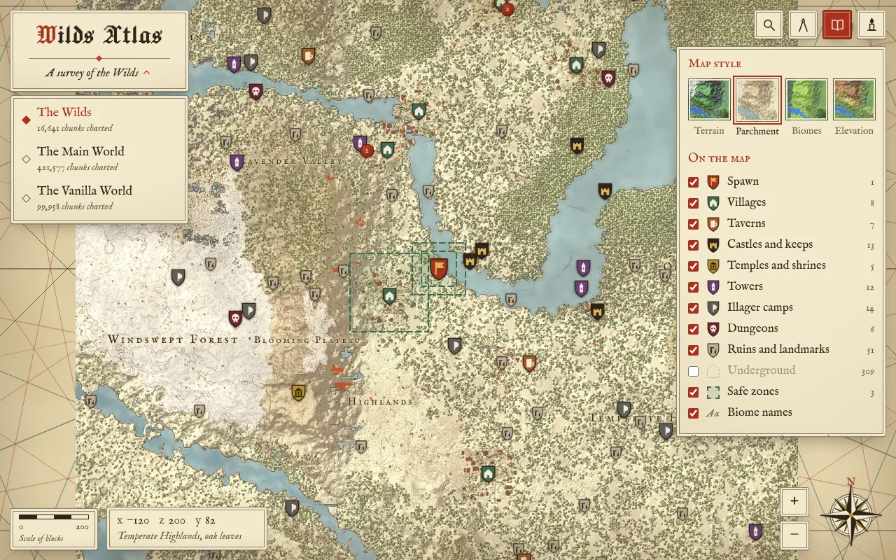

# Wilds Atlas

Maps of our medieval RPG Minecraft server, styled like an old chart: the Wilds, the Main World and the Vanilla World. They are rendered from the server's region files and hosted on GitHub Pages, so friends only need a link.

**https://andreyvld.github.io/wilds-atlas/**



- A map for each world, picked from the menu under the title
- Four map styles: parchment, terrain, biomes and elevation, from a whole-world view down to single blocks
- Heraldic markers for villages, taverns, keeps, temples, towers, illager camps, dungeons and ruins, read from the chunks themselves (vanilla, Terralith, Dungeons and Taverns, Structory, ATi, Grim Kingdoms and more), plus spawn, warps, waystones and WorldGuard safe zones
- Biome names, search, a distance ruler with travel times, and a readout of x, y, z, biome and block under the cursor
- Shareable links (`#main/x/z/zoom/style`), a candlelight dark mode, and phone support

The renderer reads only region files and plugin configs. Player positions, inventories, homes and the seed never leave the server.

## How it works

1. `tools/` (Python) reads `world/dimensions/.../region/*.mca` straight from the server folder and caches what it read. It draws 256 px WebP tiles for every zoom level, plus small lookup images for the cursor readout.
2. `publish` force-pushes that output as a single commit on the `map-data` branch, so the repo never grows with old maps. It then writes the commit id to `data.lock` on `main`.
3. The push to `main` runs the Pages workflow, which builds `web/` (TypeScript, Vite, Leaflet) with that map data and deploys it.

## Setup on the server PC

1. Install [Git](https://git-scm.com/download/win) and [Python 3.11+](https://www.python.org/downloads/) (tick "Add python.exe to PATH").
2. Clone the repo next to the server folder, so `config.toml` finds `../OG Server/minecraft-server`:
   ```
   cd D:\minecraft-servers
   git clone https://github.com/AndreyVLD/wilds-atlas
   cd wilds-atlas
   pip install -r tools/requirements.txt
   ```
3. On GitHub, open **Settings → Pages** and set **Source** to **GitHub Actions**.
4. Double-click `atlas.bat`. The first run draws every world from scratch, which takes a while, and asks you to sign in to GitHub once.
5. Double-click `schedule.bat`. It adds a Windows scheduled task, "Wilds Atlas", that publishes all the worlds every night at 23:00.

## Updating the map

The nightly task runs in the background without a window and logs its last run to `cache/nightly.log`. It runs while you are signed in to Windows; if the PC was asleep or off at 23:00, it runs as soon as it can. To update right away, double-click `atlas.bat`, or run:

```
python tools/atlas.py publish
```

Only regions whose files changed since the last run are read and redrawn: new chunks from Chunky or from exploring, and builds. When nothing changed, nothing is pushed. The site updates a minute or two after a push. Running it while the server is up is fine. Paper writes chunks to disk every few minutes, and `save-all` first catches the rest. Add `--full` to redraw everything.

`schedule.bat 03:00` moves the nightly run to another time. To remove the task, run `schtasks /Delete /TN "Wilds Atlas" /F`.

## Settings

`config.toml` holds the title, the server path, the worlds to map and display names for safe zones and warps. Each `[[worlds]]` entry is one map in the world menu, in the same order; the first is the one the site opens on.

## Working on the site

```
python tools/atlas.py build        # render into web/public/maps without publishing
cd web
npm install
npm run dev                        # http://localhost:5173
```

| Path | What it holds |
| --- | --- |
| `tools/atlas.py` | Command line, incremental build, publish |
| `tools/scan.py` | Region and NBT reader, about 2 ms per chunk |
| `tools/render.py` | Block and biome colours, the four styles, tile output |
| `tools/world.py` | Structures, spawn, warps, zones, waystones, biome labels |
| `tools/schedule.ps1` | The nightly task, set up by `schedule.bat` |
| `web/src/` | The site: map, world menu, markers, readout, search and ruler |
